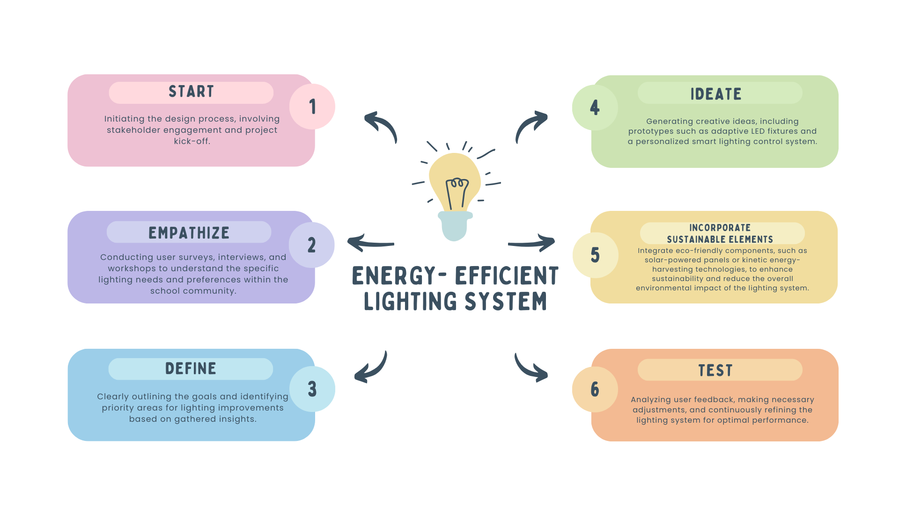
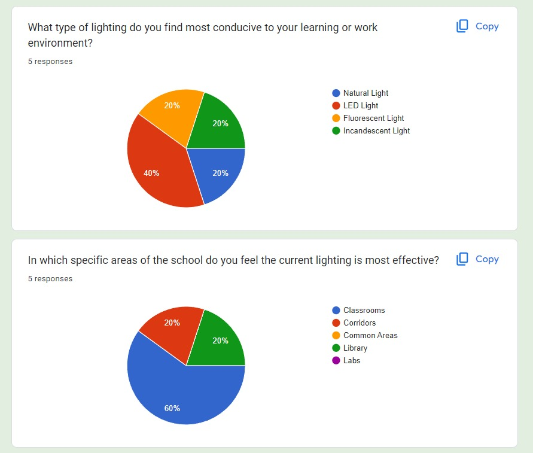

# SchoolLight: Energy-Efficient Lighting System for Schools

A 2023 design-thinking project exploring how schools could improve lighting comfort, safety, and energy efficiency through a combination of LED lighting, motion-sensor lighting, and solar-powered lighting.

> **Project status:** Conceptual design proposal. The original presentation describes a proposed pilot and phased rollout; it does not provide evidence that a physical installation or measured energy-saving trial was completed.

## Overview

Conventional school lighting can create avoidable energy use and may not suit the needs of every space. SchoolLight explores a school-specific approach: select lighting solutions according to how each area is used, while considering the experience of students, teachers, and staff.

The project follows a design-thinking process: understand users, define the problem, generate ideas, develop a conceptual prototype, outline implementation, and identify how the design could be tested and refined.

## The proposed concept

| School area | Proposed solution | Intended value |
|---|---|---|
| Classrooms | Energy-efficient LED bulbs with adjustable brightness | Consistent, comfortable lighting for lessons and long periods of use |
| Corridors | Motion-sensor-activated LED bulbs | Light when movement is detected, reducing unnecessary operation in idle periods |
| Laboratories and auditorium | Solar-powered LED lighting with battery backup | Renewable-energy use and backup lighting during grid interruptions |

The original presentation also proposes a personalized smart-lighting control system. Users could adjust brightness, colour temperature, and lighting patterns, with automated sensors supporting more efficient operation. These are proposed design features, not verified product specifications or a deployed system.

## Project visuals

**Design-thinking blueprint from the original presentation**

**Survey chart examples from the original presentation**

## Design-thinking process

1. **Empathize** — Gather perspectives from students and staff through surveys, interviews, workshops, and a Google Form feedback tool.
2. **Define** — Set goals around energy efficiency, learning-environment quality, and adaptability; identify priority spaces such as classrooms, corridors, and common areas.
3. **Ideate** — Develop the personalized smart-lighting concept and area-specific lighting choices.
4. **Prototype** — Present a planning blueprint and a collection of lighting concepts.
5. **Implement (proposed)** — Outline an initial pilot in the IBCP Block, followed by a possible phased expansion to other school blocks.
6. **Test (proposed)** — Evaluate energy consumption, lighting quality, and user feedback, then refine the design.

## Research and evidence

The original presentation includes survey charts on lighting preferences, areas where lighting was considered effective or lacking, perceived effects on mood and productivity, colour-temperature preferences, and interest in smart controls.

The charts show **five responses** for the questions displayed on slides 5 and 6, and **five and three responses** for the two questions displayed on slide 7. This is a very small exploratory sample. It should not be treated as representative of the whole school. The original slide charts are preserved in [`assets/images/`](assets/images/) and the survey limitations are discussed in [`documentation/survey-analysis.md`](documentation/survey-analysis.md).

## Repository guide

- [`presentation/original-project-2023.pptx`](presentation/original-project-2023.pptx) — Original 15-slide presentation, preserved as submitted.
- [`documentation/introduction.md`](documentation/introduction.md) — Context, scope, and project framing.
- [`documentation/design-thinking-process.md`](documentation/design-thinking-process.md) — The six stages used in the proposal.
- [`documentation/proposed-solutions.md`](documentation/proposed-solutions.md) — Area-wise lighting concepts and intended benefits.
- [`documentation/implementation-plan.md`](documentation/implementation-plan.md) — Proposed pilot, rollout, and evaluation approach.
- [`documentation/survey-analysis.md`](documentation/survey-analysis.md) — What the original survey charts show and their limitations.
- [`research/references.md`](research/references.md) — References cited in the original presentation.
- [`assets/images/`](assets/images/) — Images extracted from the original presentation, including survey charts and concept visuals.

## Scope and limitations

- This repository documents a conceptual design project; it is not a record of a completed installation.
- No verified electricity-consumption baseline, post-installation measurements, cost model, or quantified savings are supplied in the original presentation.
- The survey sample is small and exploratory; raw response-level data was not included in the presentation file.
- Sensor behaviour, solar sizing, battery capacity, electrical safety, maintenance, and procurement would need detailed engineering review before any real-world deployment.

## Original submission and attribution

This repository is independently maintained and documented by **Dibyajyoti Swain** as a personal portfolio record. The source presentation identifies the original assignment as a group submission and lists the following contributors:

**Aarish, Ashutosh, Dibyajyoti, Deepanshu, Dipika, and Vivaan.**

The original presentation is retained in `presentation/` to preserve that group-submission context. The repository does not claim that the original assignment was submitted individually or that the other contributors had no involvement.

## References

The two references listed in the original presentation are reproduced in [`research/references.md`](research/references.md).

## Future improvements

- Add the original survey form or raw responses, if available and shareable.
- Develop a more detailed lighting-zone plan and system architecture.
- Estimate lighting loads and compare baseline and proposed energy use.
- Evaluate sensor placement, control logic, solar generation, and battery requirements.
- Conduct a larger user study and document measurable test results.

---

*Prepared as an independent GitHub documentation project in 2026, preserving the original 2023 group presentation.*
